# Portfolio manager report — 2026-11-02
Book **$10,817** (risky $9,810 + cash $1,007). Window 2024-01-02 → 2026-11-02 (711 trading days). Beta to QQQM 1.15.

_Policy: your portfolio is aggressive on purpose. A trim is recommended only if it lowers risk AND does not lower return (in-sample test of that trim + walk-forward backtest). Everything else is reported as a risk you are choosing._

## Recommendations (most important first)
1. **Trim BTC: lowers risk AND raises return in the tests**  
   BTC is 24% of capital and 30% of risk. Cutting it to ~13.8% of the book (excess spread pro-rata) moves vol 31.1% → 30.3% and return 40.0% → 41.7% (in-sample); walk-forward backtest gate: PASS. Passes your rule, but both tests share one regime (crypto lagged), so size the trim to what you are comfortable with.
2. **Trim ETH: lowers risk AND raises return in the tests**  
   ETH is 10% of capital and 18% of risk. Cutting it to ~6.4% of the book (excess spread pro-rata) moves vol 31.1% → 30.4% and return 40.0% → 41.1% (in-sample); walk-forward backtest gate: PASS. Passes your rule, but both tests share one regime (crypto lagged), so size the trim to what you are comfortable with.
3. **Optional rebalance passes your rule (~16% turnover): sell BTC $872, QQQM $288, ETH $284, SMH $239; buy LLY $525, ITA $483, UFO $277, QTUM $207, NLR $190**  
   in-sample vol 31.1% → 27.9%, return 40.0% → 41.6%. Walk-forward, net of costs, monthly: vol -2.4pt and CAGR +7.3pt vs holding the mix, in both halves. Caveat: one window where crypto lagged; do it gradually with new cash first.
4. **Crypto is 35% of your book and 57% of the risk**  
   Know this number: it is your single biggest driver of drawdowns. Capping crypto at 30% of the sleeve in the backtest changed vol -1.3pt and net CAGR +4.4pt vs holding the mix (passes your gate). UNI, NEAR are <3% each: too small to move return but they add alt-coin risk (optional tidy-up: fold into BTC/ETH, or size up on purpose).
5. **Thesis check (>20% below 1-year high): NLR -45%, SKHY -42%, ETH -42%, UFO -40%, UNI -31%, BTC -30%, VST -29%, NEAR -27%, SMH -23%, QTUM -21%**  
   A drawdown alone is not a sell signal. If the reason you bought is intact, these are candidates for new cash, not for selling.
6. **AI/semis/tech = 38% of book, 32% of risk (avg correlation 0.64): accepted concentration**  
   QQQM, SMH, NVDA, SKHY, QTUM are largely one trade (QQQM and SMH already hold NVDA/semis). No trim recommended; just know that a semis sell-off hits all five at once, and don't count them as diversification.
7. **If you add risk, the best diversifiers you already own are LLY, VST**  
   Lowest average correlation to everything else (LLY 0.09, VST 0.34).
8. **Cash 9.3% ($1,007): dry powder for new positions**  
   At 28% whole-book volatility a 10% pullback is a normal event. Deploy in tranches; new cash (e.g. your planned 2-3% HOOD) avoids selling anything. Cash earns ~4.0% at my assumed risk-free rate.

See also: [check-in & alerts](checkin.md) · [stress tests](stress.md) · [signals](signals.md) · [backtest](backtest.md) · [FinQuant optimiser](fq_optimise.md) · [watchlist](watchlist.md) · [tax lots](tax_lots.md)

## Charts
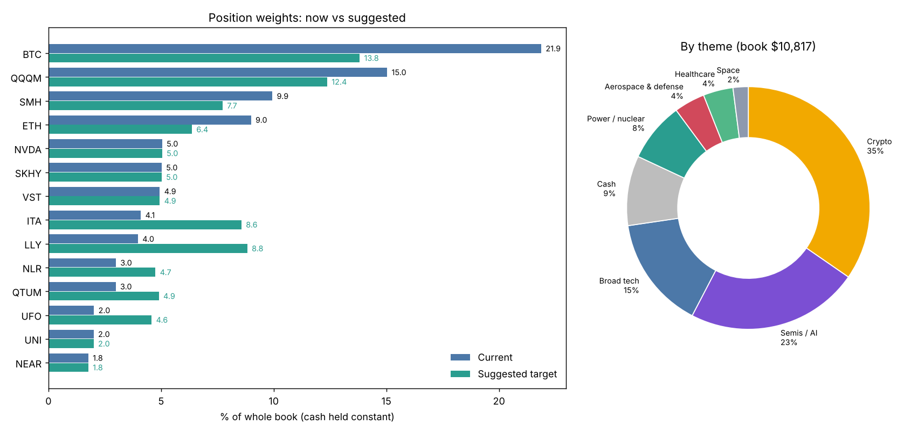
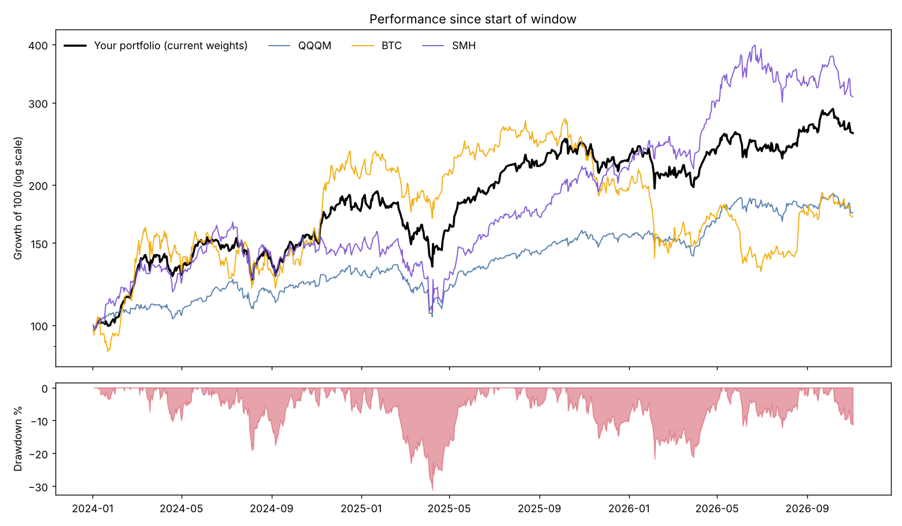
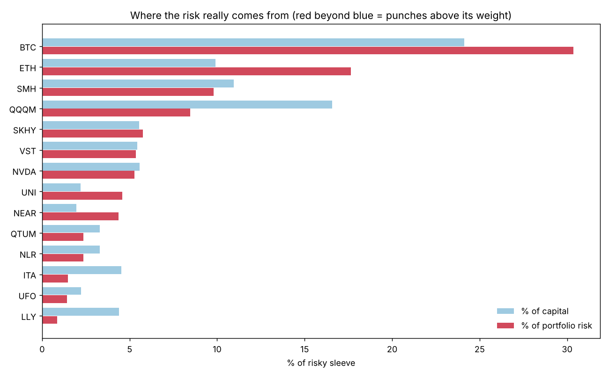
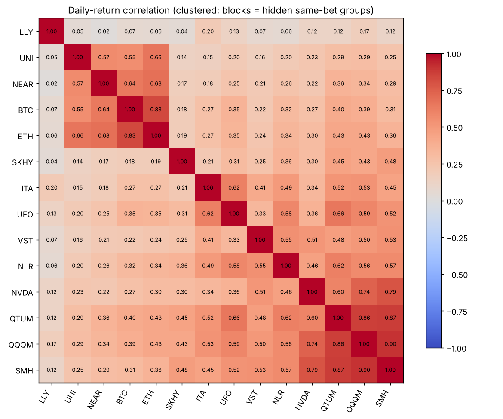
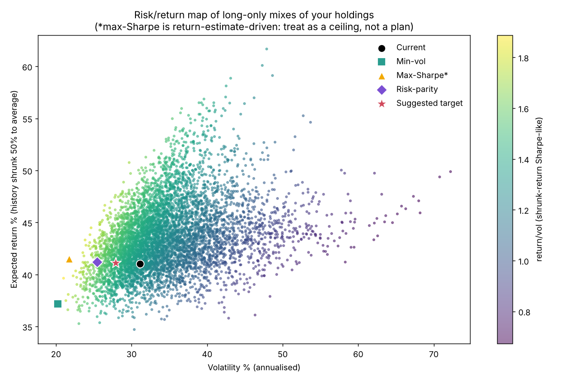
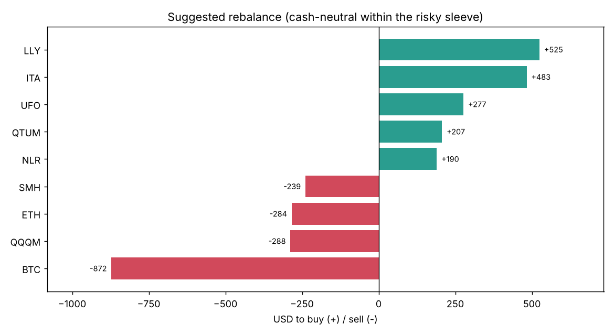
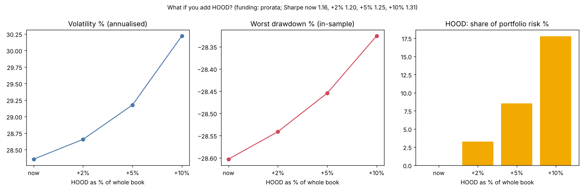
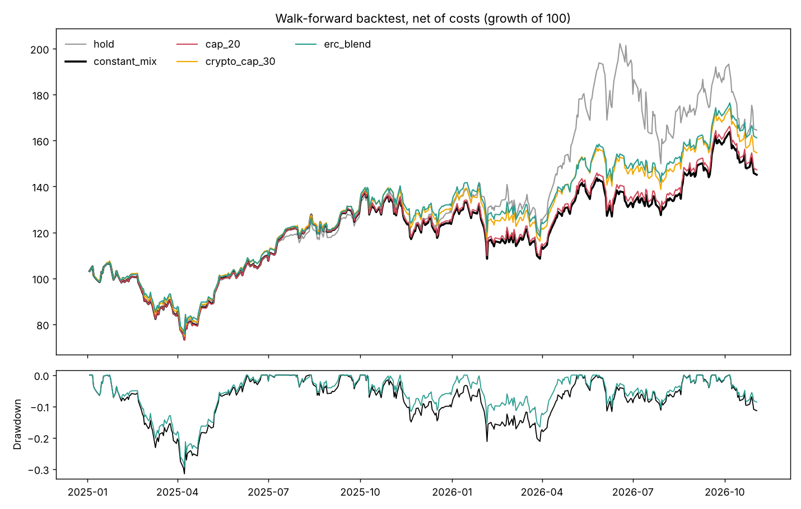
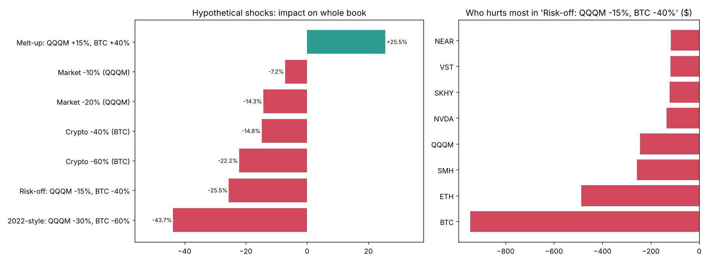
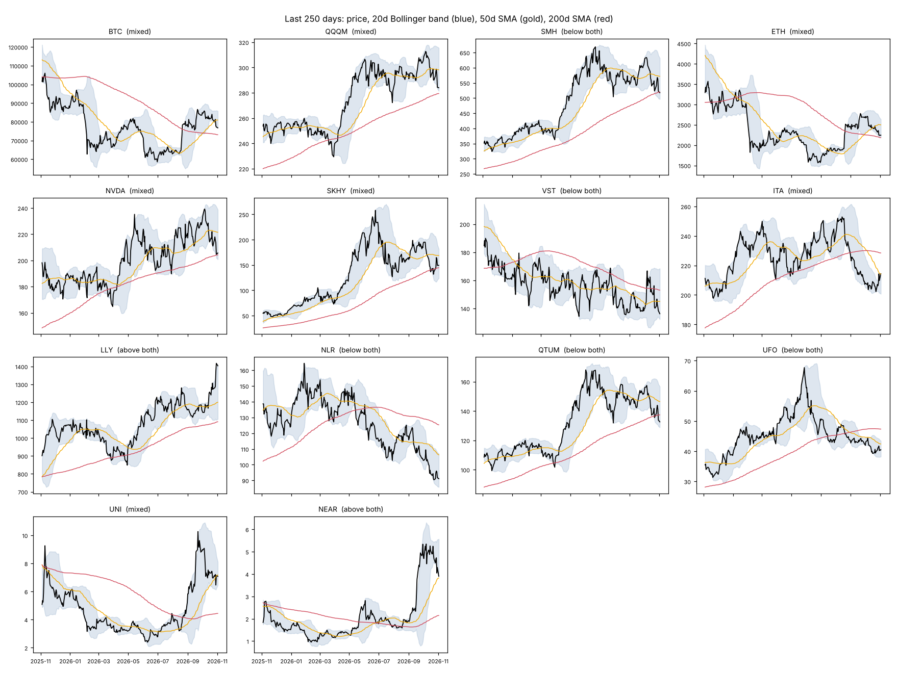
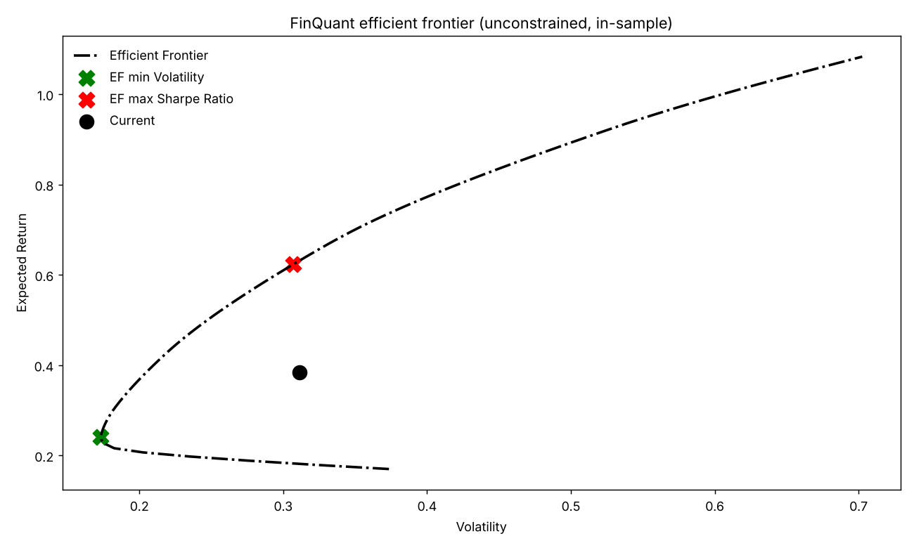
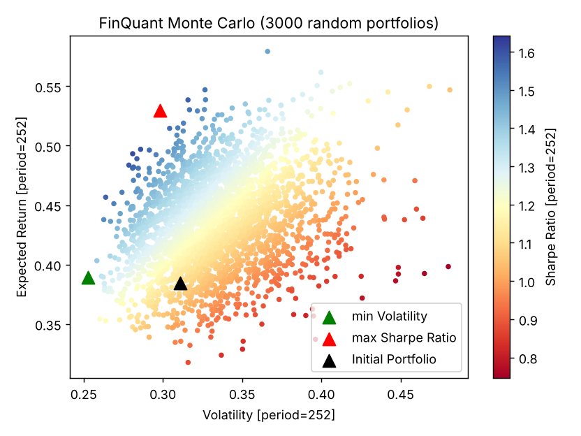

## Positions
| Ticker | theme | price | value | w_book | pnl_pct | vol | risk_share |
|---|---|---|---|---|---|---|---|
| BTC | Crypto | 76,755.75 | $2,366 | 21.9% | -0.9% | 47% | 30.4% |
| QQQM | Broad tech | 284.00 | $1,626 | 15.0% | -0.1% | 21% | 8.5% |
| SMH | Semis / AI | 517.68 | $1,075 | 9.9% | -0.9% | 38% | 9.8% |
| ETH | Crypto | 2,243.40 | $973 | 9.0% | -0.4% | 67% | 17.6% |
| NVDA | Semis / AI | 205.64 | $546 | 5.0% | +0.5% | 47% | 5.3% |
| SKHY | Semis / AI | 149.27 | $543 | 5.0% | +0.0% | 70% | 5.8% |
| VST | Power / nuclear | 136.20 | $534 | 4.9% | -1.6% | 59% | 5.4% |
| ITA | Aerospace & defense | 214.36 | $444 | 4.1% | +2.2% | 21% | 1.5% |
| LLY | Healthcare | 1,403.53 | $430 | 4.0% | -1.0% | 36% | 0.8% |
| NLR | Power / nuclear | 91.11 | $324 | 3.0% | -0.7% | 38% | 2.4% |
| QTUM | Semis / AI | 132.61 | $323 | 3.0% | -0.9% | 30% | 2.4% |
| UFO | Space | 40.49 | $218 | 2.0% | +0.6% | 35% | 1.4% |
| UNI | Crypto | 7.08 | $217 | 2.0% | -0.1% | 107% | 4.6% |
| NEAR | Crypto | 3.91 | $191 | 1.8% | -11.8% | 105% | 4.4% |

## Portfolio variants (in-sample, constant weights)
| Portfolio | ann_return | vol | sharpe | max_dd | var95_1d | cvar95_1d |
|---|---|---|---|---|---|---|
| Current | 40.0% | 31.1% | 1.16 | -31.1% | 2.93% | 4.10% |
| Min-vol | 33.2% | 20.2% | 1.45 | -20.2% | 1.98% | 2.81% |
| Max-Sharpe* | 44.9% | 21.7% | 1.88 | -20.6% | 2.05% | 2.98% |
| Risk-parity | 42.8% | 25.4% | 1.53 | -26.6% | 2.37% | 3.54% |
| Suggested target | 41.6% | 27.9% | 1.35 | -28.8% | 2.57% | 3.78% |

Out-of-sample sanity check: risk-parity weights fitted on the first half, run on the second half → vol 25.0% vs 28.9% for your current mix; max drawdown -14% vs -22%.

## Rebalance trades
| Ticker | now_book | tgt_book | trade_usd |
|---|---|---|---|
| BTC | 21.9% | 13.8% | -872 |
| ETH | 9.0% | 6.4% | -284 |
| UNI | 2.0% | 2.0% | +0 |
| NEAR | 1.8% | 1.8% | +0 |
| QQQM | 15.0% | 12.4% | -288 |
| SMH | 9.9% | 7.7% | -239 |
| NVDA | 5.0% | 5.0% | +0 |
| SKHY | 5.0% | 5.0% | +0 |
| VST | 4.9% | 4.9% | +0 |
| LLY | 4.0% | 8.8% | +525 |
| ITA | 4.1% | 8.6% | +483 |
| NLR | 3.0% | 4.7% | +190 |
| QTUM | 3.0% | 4.9% | +207 |
| UFO | 2.0% | 4.6% | +277 |

## Caveats
- In-sample history, constant weights; the window includes a strong crypto/AI bull run, which flatters returns.
- SKHY before 2026-07-10 is a proxy from the Korean listing (000660.KS → USD, scaled, shifted a day).
- Assumptions I made, not facts: risk-free 4.0%, max 20% per asset.
- Research tool, not licensed financial advice; check tax, fees and your own time horizon before trading.
